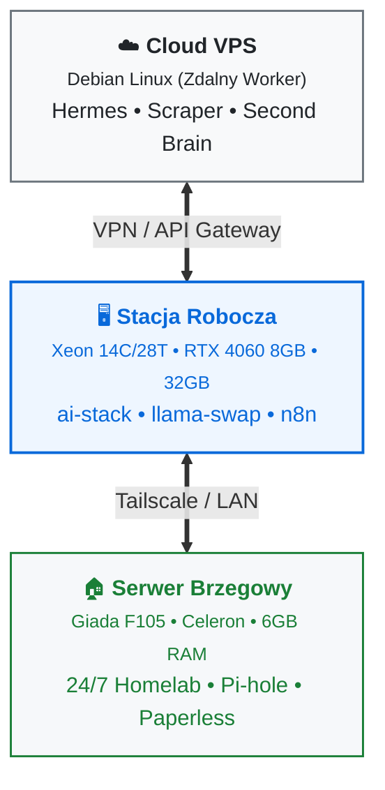

# Portfolio: Local AI, DevOps & Edge Infrastructure

> **Inżynier:** Damian  
> **Lokalizacja:** Bydgoszcz, Polska  
> **Główne specjalizacje:** Architektura Local AI & LLM Inference, DevOps & Self-hosted Homelab, Systemy Agentowe (Multi-Agent Systems), Pipeline'y Danych & Scraping E-commerce.

---

## 1. O mnie i podejściu do inżynierii

Buduję systemy oparte o **lokalne modele AI, konteneryzację i architekturę brzegową (edge)**. 

Zamiast polegać wyłącznie na drogich API chmurowych, projektuję rozwiązania w paradygmacie **Local-First & Cost-Efficiency** – wyciskając maksimum z dostępnych zasobów sprzętowych:

- **Local AI na twardych limitach:** Uruchamianie i optymalizacja modeli open-source (Gemma, Qwen, Bielik) pod 8 GB VRAM i 6 GB RAM, ze wsparciem dynamicznego swapu wag GGUF oraz precyzyjnym odciążaniem warstw GPU (`llama-swap`).
- **Bezpieczny i przetestowany DevOps:** Usługi działające w odizolowanych kontenerach (użytkownicy non-root, `no-new-privileges`, binding wyłącznie do `127.0.0.1`), z orkiestracją Docker Compose i testami E2E w `pytest`.
- **Autonomiczne agenty i automatyzacja:** Orkiestracja zadań wieloagentowych (Hermes, Damian.Core RAG, n8n), asynchroniczne generatory multimediów oraz odporne pipeline'y scrapingowe (bypass zabezpieczeń bot-protection).

---

## 2. Topologia Sprzętowa (Hardware Context)

Wszystkie projekty projektowane są pod konkretne węzły obliczeniowe z pełną świadomością ograniczeń pamięciowych i I/O:

| Węzeł | Rola i przeznaczenie | Sprzęt i ograniczenia | Kluczowe serwisy |
| :--- | :--- | :--- | :--- |
| **☁️ Cloud VPS** | Zdalny worker & supervisor | Debian Linux VPS | Hermes Supervisor, Hybrid Scraper, Freqtrade, Obsidian Second Brain |
| **🖥️ Stacja Robocza** | Heavy AI Inference & R&D | Intel Xeon E5-2697 v3 (14C/28T) RTX 4060 8GB, 32 GB DDR4 | `ai-stack`: llama-swap, ComfyUI, Open-WebUI, n8n, Crawl4AI |
| **🏠 Giada F105** | Always-On 24/7 Homelab | Intel Celeron N3350/N3450 (pasywne) 6 GB RAM, SSD 64GB + HDD 320GB | `giada-mieszkanie`: Portainer, Pi-hole, Paperless-ngx, Audiobookshelf, Kuma |

---

## 3. Matryca Projektów

| Projekt | Obszar | Główne technologie | Status | Kluczowe wyzwanie techniczne |
|---|---|---|---|---|
| [**01. AI-Stack**](projects/01-ai-stack/README.md) | Local AI & LLM | `Docker`, `CUDA`, `llama-swap`, `ComfyUI`, `Open-WebUI`, `n8n`, `Crawl4AI` | **Produkcja** | Dynamiczny swap modeli GGUF i optymalizacja warstw GPU w 8 GB VRAM. |
| [**02. Giada Homelab**](projects/02-giada-homelab/README.md) | DevOps & Edge | `Docker Compose`, `Portainer`, `Pi-hole`, `Paperless-ngx`, `SQLite`, `pytest` | **Produkcja** | Wdrożenie 7 usług w 6 GB RAM na procesorze Celeron bez transkodowania. |
| [**03. Building Materials Analyzer**](projects/03-building-materials-analyzer/README.md) | Data Science & ML | `Python`, `FastAPI`, `Pandas`, `Scikit-Learn`, `Web Scraping` | **Aktywny** | Predykcja trendów cenowych materiałów budowlanych na podstawie danych e-commerce. |
| [**04. Hermes Multi-Agent VPS**](projects/04-hermes-agentic-vps/README.md) | Agentic AI | `Hermes Gateway`, `Damian.Core`, `Qdrant RAG`, `Obsidian Vault`, `Python` | **Aktywny** | Wielomodelowy routing agentów, pamięć długoterminowa i bypass Cloudflare. |
| [**05. Content Automation**](projects/05-content-automation/README.md) | Multimedia AI | `Celery`, `Python`, `Edge-TTS`, `Silero`, `FFmpeg`, `MoviePy` | **Aktywny** | Asynchroniczny pipeline wideo z polskim emocjonalnym syntezatorem mowy. |

---

## 4. Szczegółowe Spisy Treści Projektów

1. [`projects/01-ai-stack/`](projects/01-ai-stack/README.md) – Pełna dokumentacja lokalnego stacku inferencyjnego AI na stacji roboczej.
2. [`projects/02-giada-homelab/`](projects/02-giada-homelab/README.md) – Produkcyjny homelab z frameworkiem testowym E2E.
3. [`projects/03-building-materials-analyzer/`](projects/03-building-materials-analyzer/README.md) – Architektura pipeline'u analitycznego materiałów budowlanych.
4. [`projects/04-hermes-agentic-vps/`](projects/04-hermes-agentic-vps/README.md) – Ekosystem agentowy Hermes i integracja z Second Brain.
5. [`projects/05-content-automation/`](projects/05-content-automation/README.md) – Asynchroniczny generator multimediów wideo.
6. [`architecture/hardware-matrix.md`](architecture/hardware-matrix.md) – Szczegółowa specyfikacja i podział ról węzłów sprzętowych.
7. [`architecture/tech-stack-overview.md`](architecture/tech-stack-overview.md) – Kompendium stosu technologicznego i bibliotek.
