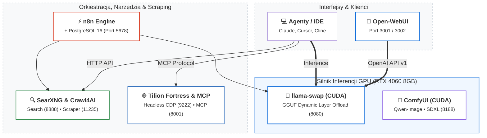

# Projekt 01: AI-Stack — Lokalny Ekosystem Inferencji AI i Automatyzacji

> **Lokalizacja na dysku:** `G:\ai-stack`  
> **Środowisko docelowe:** Stacja Robocza (Intel Xeon E5-2697 v3 14C/28T, 32 GB RAM, NVIDIA RTX 4060 8GB)  
> **Sieć wewnętrzna:** `ai-net` (Docker Bridge)

---

## 1. Cel i Architektura Systemu

AI-Stack to w pełni skonteneryzowany, lokalny ekosystem sztucznej inteligencji, zapewniający samowystarczalność obliczeniową bez polegania na płatnych API chmurowych. System łączy:
1. **Wysokowydajną inferencję LLM** z dynamicznym przełączaniem modeli w pamięci VRAM.
2. **Generowanie obrazów i widzenie komputerowe** (ComfyUI z modelami GGUF i Qwen Image).
3. **Orkiestrację przepływów agentowych** (n8n z bazą PostgreSQL).
4. **Prywatne wyszukiwanie i zaawansowany scraping** (SearXNG, Crawl4AI, Tilion Fortress CDP, MCP Browser).



---

## 2. Zestawienie Kontenerów i Usług

| Usługa | Plik Compose | Obraz | Porty | Rola i Konfiguracja |
|---|---|---|---|---|
| **llama-swap** | `llama-swap.yaml` | `ghcr.io/mostlygeek/llama-swap:cuda` | `8080:8080` | Serwer inferencji z obsługą dynamicznego swapu modeli GGUF, Flash Attention i kwantyzacji KV Cache. |
| **open-webui** | `open-webui.yaml` | `ghcr.io/open-webui/open-webui:main` | `3001:8080` | Główny interfejs czatu dla użytkownika zintegrowany z `llama-swap:8080/v1`. |
| **open-webui-new** | `open-webui.yaml` | `ghcr.io/open-webui/open-webui:main` | `3002:8080` | Izolowana instancja stagingowa Open-WebUI do testowania nowych integracji. |
| **comfyui** | `comfyui.yaml` | `jimlee2048/comfyui-docker:latest` | `8188:8188` | Silnik nodów generatywnego AI z preinstalowanym węzłem `ComfyUI-GGUF` i wagami `Qwen-Image 2.1`. |
| **n8n** | `n8n.yaml` | `docker.n8n.io/n8nio/n8n:latest` | `5678:5678` | Automatyzacja przepływów biznesowych i integracji API. |
| **n8n-postgres** | `n8n.yaml` | `postgres:16-alpine` | *wewnętrzny (5432)* | Dedykowana baza relacyjna PostgreSQL dla instancji n8n. |
| **searxng** | `searxng.yaml` | `docker.io/searxng/searxng:latest` | `8888:8080` | Prywatna metawyszukiwarka udostępniająca API wyszukiwania dla agentów AI. |
| **crawl4ai** | `crawl4ai.yaml` | `unclecode/crawl4ai:latest` | `11235:11235` | Ekstrakcja treści stron WWW z silnikiem antydetekcyjnym i generowaniem markdowna. |
| **tilion** | `tilion.yaml` | `tilion/fortress:latest` | `9222:9222` | Zaawansowana przeglądarka headless CDP (Chrome DevTools Protocol) z obsługą proxy rezydencjalnego i solverów CAPTCHA. |
| **mcp-browser** | `mcp-browser.yaml`| `node:20-alpine` | `8001:8000` | Serwer protokołu MCP (Model Context Protocol) umożliwiający agentom LLM interakcję z Chromium. |

---

## 3. Inżynieria Modeli LLM w `llama-swap`

Kluczowym elementem optymalizacyjnym jest precyzyjny dobór liczby warstw przekazywanych do karty graficznej (`--n-gpu-layers`), aby maksymalnie wykorzystać 8 GB VRAM RTX 4060 bez wywoływania błędów CUDA Out Of Memory:

1. **`Qwen3.8-9B-heretic-uncensored:Q6_K`** (~7.36 GB):
   - Architektura: 32 warstwy (Gated DeltaNet).
   - Offload GPU: **29 warstw** na GPU.
   - Pamięć kontekstu: `32768` tokenów z kwantyzacją KV Cache (`--cache-type-k q8_0`, `--cache-type-v q8_0`) oraz `--flash-attn on`.
2. **`gemma-4-12B-it-heretic:Q4_K_M`** (~7.1 GB):
   - Architektura: 48 warstw.
   - Offload GPU: **41 warstw** na GPU (wykorzystanie Sliding Window zoptymalizowanego pod stały bufor KV).
   - Kontekst: `16384` tokenów.
3. **`gemma-4-12B-coder-fable5:Q8_0`** (~12.7 GB):
   - Model kodujący o bezkompromisowej precyzji Q8_0 (~260 MB/warstwa).
   - Offload GPU: **26 warstw** na GPU, reszta przetwarzana wielowątkowo na 14 rdzeniach CPU Xeon.
4. **`Gemma-4-E4B-Uncensored-HauHauCS:Q6_K_P`** (~4.2 GB):
   - Offload GPU: **99 warstw (100% w VRAM)**.
   - Kontekst: `65536` tokenów.
   - Przepustowość: **~75+ tokenów/s**.

Szczegółowa analiza alokacji pamięci: [llama-swap-optimization.md](llama-swap-optimization.md).

---

## 4. Procedura Uruchomieniowa

Stack orkiestrowany jest automatycznym skryptem PowerShell `start-stack.ps1`:
```powershell
# Uruchomienie całego środowiska z automatycznym tworzeniem sieci 'ai-net'
.\start-stack.ps1
```
Skrypt wykonuje sekwencyjny rozruch:
1. Sprawdzenie stanu demona Docker Desktop.
2. Weryfikacja i utworzenie sieci mostkowej `ai-net`.
3. Start bazy danych `n8n-postgres` i silnika `n8n`.
4. Start modułów wyszukiwania `searxng` i scrapingu `crawl4ai`.
5. Start silnika inferencji `llama-swap`, `open-webui`, `comfyui`, `mcp-browser` oraz `tilion`.
