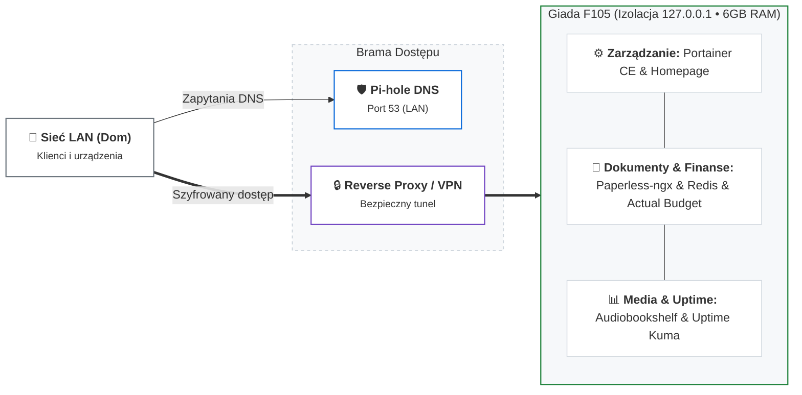

# Projekt 02: Giada Homelab — Self-hosted Stack na Słabe Urządzenia

> **Lokalizacja na dysku:** `G:\giada-mieszkanie`  
> **Sprzęt docelowy:** Giada F105 (Intel Celeron N3350/N3450, 2 rdzenie, 6 GB RAM, 64 GB SSD + 320 GB HDD)  
> **System bazowy:** Debian 12 / Ubuntu Server 24.04 LTS (Headless)

---

## 1. Wyzwanie Inżynieryjne i Świadome Decyzje

Uruchomienie kompletnego środowiska usług domowych na 2-rdzeniowym procesorze Celeron o niskiej wydajności jednowątkowej oraz współdzielonej pamięci 6 GB RAM wymagało odrzucenia domyślnych, zasobożernych konfiguracji:

1. **Eliminacja transkodowania wideo:** Rezygnacja z Jellyfin/Plex – słaby procesor Apollo Lake nie udźwignie transkodowania w czasie rzeczywistym.
2. **Architektura OCR Offloading:** Paperless-ngx na tym węźle pełni rolę wyłącznie magazynu, interfejsu i bazy dokumentów (`PAPERLESS_OCR_MODE=skip`). Przetwarzanie OCR oddelegowane jest do stacji roboczej Xeon E5-2697.
3. **Bazy danych SQLite zamiast PostgreSQL:** Zastosowanie SQLite (Paperless, Audiobookshelf, Uptime Kuma, Actual Budget) wyeliminowało konieczność utrzymywania wielu procesów PostgreSQL, oszczędzając ~400–600 MB RAM.
4. **Ultralekki Redis:** Paperless wymaga kolejki asynchronicznej Celery – wdrożono `redis:7.4.2-alpine` z pamięcią ograniczoną do 64 MB i wyłączonym zapisem na dysk (`--save "" --appendonly no`).
5. **Separacja nośników:** Bazy danych i pliki konfiguracyjne zlokalizowano na szybkim SSD 64 GB (ochrona przed blokadami SQLite), a magazyny multimediów na HDD 320 GB.

---

## 2. Zestawienie Usług

| Usługa | Plik YAML | Obraz | Port hosta | Typ bazy | Szacowany RAM |
|---|---|---|---|---|---|
| **Portainer CE** | `portainer.yml` | `portainer/portainer-ce:2.27.1` | `127.0.0.1:9443` | BoltDB | ~30 MB |
| **Pi-hole** | `pihole.yml` | `pihole/pihole:2024.07.0` | `53` (LAN), `127.0.0.1:8053` | SQLite (FTL) | ~50 MB |
| **Paperless + Redis** | `paperless-ngx.yml` | `ghcr.io/...:2.14.7` + `redis:alpine` | `127.0.0.1:8000` | SQLite + RAM queue | ~280–450 MB |
| **Audiobookshelf** | `audiobookshelf.yml` | `ghcr.io/...:2.19.5` | `127.0.0.1:13378` | SQLite | ~100–150 MB |
| **Uptime Kuma** | `uptime-kuma.yml` | `louislam/...:1.23.16` | `127.0.0.1:3001` | SQLite | ~70–100 MB |
| **Homepage** | `homepage.yml` | `ghcr.io/...:v0.10.9` | `127.0.0.1:3000` | Brak (statyczny Node) | ~40–60 MB |
| **Actual Budget** | `budget.yml` | `actualbudget/...:25.3.0-alpine` | `127.0.0.1:5006` | SQLite | ~35–50 MB |
| **Suma stacku** | - | - | - | - | **~600–900 MB** |

---

## 3. Bezpieczeństwo i Dobre Praktyki

- **Brak root w kontenerach:** Konfiguracja `user: "1000:1000"` lub `PUID=1000, PGID=1000`.
- **Prewencja eskalacji uprawnień:** Flaga `security_opt: [no-new-privileges:true]` w każdym kontenerze.
- **Lokalne bindowanie:** Brak wystawiania paneli administracyjnych do publicznego LAN – dostęp realizowany wyłącznie przez Reverse Proxy lub bezpieczny tunel VPN.
- **Zabezpieczenie Docker Socket:** W kontenerze Homepage gniazdo zamontowane wyłącznie do odczytu (`/var/run/docker.sock:ro`).

Szczegółowa dokumentacja frameworka testowego E2E: [e2e-testing-framework.md](e2e-testing-framework.md).
