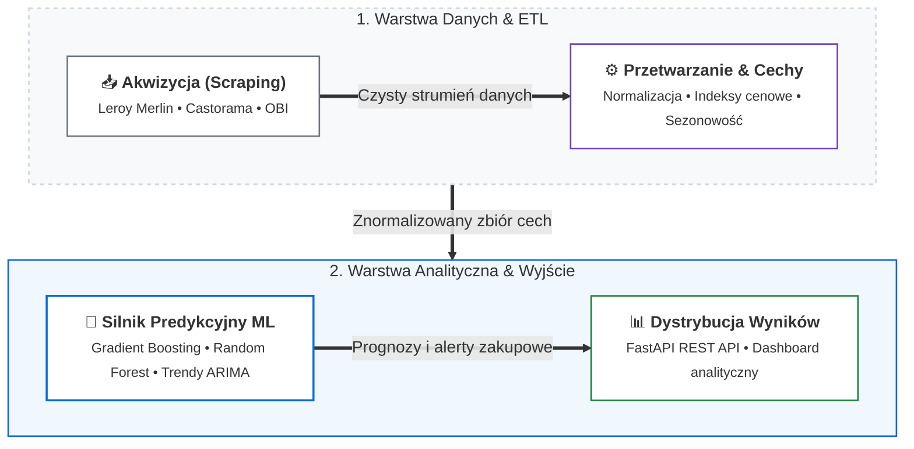

# Projekt 03: Building Materials Analyzer — Predykcja Cen Materiałów Budowlanych

> **Lokalizacja na dysku:** `G:\IT\Vibe coding\Predykcja cen materiałów budowlanych\building_materials_analyzer`  
> **Stos technologiczny:** Python 3.11+, Scikit-Learn, Pandas, NumPy, FastAPI, BeautifulSoup4, Pytest

---

## 1. Cel i Zakres Projektu

System automatyzujący pozyskiwanie, czyszczenie i analizę predykcyjną cen materiałów budowlanych na rynku polskim. Projekt powstał z myślą o optymalizacji kosztów inwestycji budowlanych poprzez identyfikację trendów sezonowych i prognozowanie najkorzystniejszych momentów na zakup kluczowych surowców (cement, styropian XPS, stal zbrojeniowa, wełna mineralna).

---

## 2. Kluczowe Komponenty Systemu

1. **Warstwa Akwizycji (Scraping):**
   - Dedykowane moduły scraperów dla wiodących marketów budowlanych (Leroy Merlin, Castorama).
   - Obsługa rotacji nagłówków `User-Agent`, parsowanie DOM i obsługa dynamicznych endpointów JSON.
2. **Kategorie Surowców:**
   - `Fundamenty`: bloczki betonowe, hydroizolacja.
   - `Izolacje / XPS`: styropian ekstrudowany, wełna mineralna.
   - `Konstrukcja`: stal zbrojeniowa, cement, drewno konstrukcyjne.
   - `Instalacje`: rury, armatura.
3. **Pipeline Danych i Feature Engineering:**
   - Analiza sezonowości (wpływ cyklu budowlanego wiosna-jesień na wahania cenowe).
   - Wyliczanie wskaźników kroczących (Moving Averages, Price Volatility Index).
4. **Jakość i Testy:**
   - Zestaw testów jednostkowych i integracyjnych (`test_all_models.py`, `test_dashboard.py`, `test_leroy_merlin_scraper.py`).

Szczegółowa architektura modeli uczenia maszynowego: [ml-architecture.md](ml-architecture.md).
