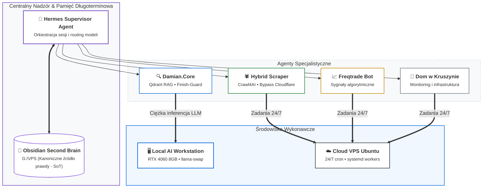

# Projekt 04: Hermes Agentic VPS & Second Brain

> **Lokalizacje na dysku:** `G:\VPS` (Obsidian Second Brain Vault), `G:\Hermes` (Środowisko modeli i narzędzi)  
> **Środowisko wykonawcze:** Cloud Linux VPS + Lokalny PC (połączenie przez Tailscale / SSH)  
> **Główne moduły:** Hermes Supervisor, Damian.Core RAG, Hybrid Scraper, Freqtrade

---

## 1. Koncepcja i Architektura Ekosystemu

Projekt realizuje architekturę rozproszonej sieci agentów autonomicznych (Agentic AI) zintegrowanej z prywatną bazą wiedzy typu Second Brain (Obsidian Vault). Węzeł VPS pełni rolę 24/7 gatewaya wykonawczego, a stacja robocza dostarcza ciężką moc obliczeniową LLM:

---

## 2. Kluczowe Podsystemy

### A. Hermes Supervisor
Główny agent nadzorujący sesje inżynieryjne, routing zapytań do modeli (Claude, Gemini, lokalne LLM) oraz automatyczne generowanie streszczeń sesji i rejestru zmian do bazy Obsidian.

### B. Damian.Core (RAG & Knowledge Base)
Moduł integrujący bazę wektorową Qdrant z wyszukiwaniem semantycznym (RAG). Wyposażony w mechanizm `finish-guard` gwarantujący ukończenie zadań i walidację wyników przed raportowaniem.

### C. Hybrid Scraper
Zaawansowany scraper agregujący zlecenia freelancingowe (Useme, Freelancehunt):
- Wykorzystanie `ai-cloudscraper` oraz `Crawl4AI` do omijania zabezpieczeń Cloudflare.
- Eksport danych do ustrukturyzowanych formatów CSV/JSON z automatyczną kategoryzacją budżetów i technologii.

### D. Obsidian Vault jako Kanoniczne Źródło Prawdy (SoT)
Hierarchiczna struktura notatek z metadanymi frontmatter, mapą projektów (`00 - Mapa projektów.md`) oraz logami audytów architektonicznych.

Szczegóły kontraktu agentowego: [multi-agent-contract.md](multi-agent-contract.md).
