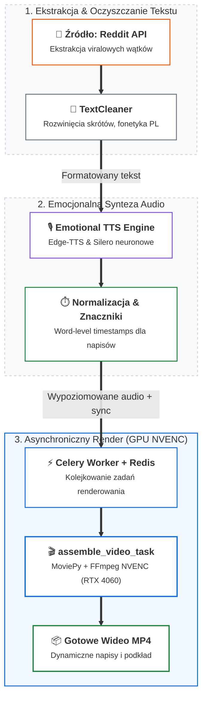

# Projekt 05: Content Automation — Asynchroniczny Pipeline Wideo i Emocjonalne TTS

> **Główny stos:** Python 3.11+, Celery, Redis, Edge-TTS, Silero TTS, FFmpeg, MoviePy

---

## 1. Cel Projektu

W pełni zautomatyzowany, asynchroniczny system generowania materiałów wideo zoptymalizowany pod platformy krótkich form (YouTube Shorts, TikTok, Reels). Pipeline orkiestruje ekstrakcję wątków z serwisów społecznościowych (Reddit), oczyszczanie i formatowanie tekstu, syntezę mowy z modulacją emocjonalną oraz dynamiczny montaż wideo.

---

## 2. Kluczowe Elementy Architektury

1. **Orkiestracja Zadania przez Celery:**
   - Rozbicie renderowania na niezależne podzadania (`generate_audio_task`, `transcribe_task`, `assemble_video_task`).
   - Monitorowanie stanu zadań i odporność na awarie pojedynczych workerów.
2. **TextCleaner & Emotional TTS:**
   - Autorski moduł `TextCleaner` przekształcający slang internetowy, skróty i emotikony na fonetyczne odpowiedniki czytane naturalnie w języku polskim.
   - Integracja z `Edge-TTS` oraz modelem neuronowym `Silero TTS` z dynamicznym doborem tonacji i tempa głosu.
3. **Wydajność Montażu Wideo (`assemble_video_task`):**
   - Optymalizacja potoku FFmpeg z wykorzystaniem akceleracji sprzętowej NVENC na karcie NVIDIA RTX 4060.
   - Generowanie dynamicznych napisów słowo-po-słowie (Word-level subtitle sync) na podstawie precyzyjnych znaczników czasowych audio.
4. **Agent Decision Logging Persistence Layer:**
   - Śledzenie decyzji podejmowanych przez modele językowe na każdym etapie montażu w celu powtarzalności i audytu jakości.
